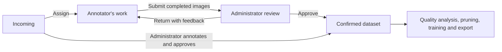

# Tator

Tator is a self-hosted platform for managing image datasets and annotating them
with help from detection, segmentation and vision-language models. The server
stores the images, annotation history and approved dataset. People sign in from
a browser to annotate, review or manage the work.

It also includes the original single-user local workbench. Both use the same
annotation canvas and drawing shortcuts; their storage and access rules differ.

**Start here:** [Use the hosted workspace](docs/hosted_workflow.rst) ·
[Deploy a server](docs/hosted_deployment.rst) ·
[All documentation](docs/index.rst)

## From incoming images to a trusted dataset

New images enter **Incoming**. They become part of the **Confirmed** dataset only
after an administrator approves their annotations.



An annotator can submit one finished image at a time. Unfinished images stay in
their work queue. The administrator can approve submitted images or return them
with a note explaining what needs changing.

| Role | What they do |
| --- | --- |
| **Administrator** | Create datasets, import images, invite users, assign work, review submissions, manage models and run dataset analysis. |
| **Annotator** | Work on their assigned images, use the available annotation tools, save drafts and submit finished work. |

Each image has one editing owner at a time. While it is assigned or returned to
an annotator, an administrator can inspect it but must explicitly take it back
before editing. Submission hands editing control to the administrator. Assignment
is limited to incoming data; confirmed images remain under administrator control.

## What you can do

- **Annotate with assistance.** Use manual boxes and polygons, SAM/SAM3 prompts,
  class prediction, detector suggestions, detection recipes and Qwen tools.
  Annotators have access to the configured first-pane tools. Model output is a
  proposal that a person reviews and applies.
- **Keep shared work orderly.** Track assignments, submissions and returned work.
  Versioned saves and editor leases protect against stale tabs and competing edits.
- **Inspect dataset quality.** Run the Data Quality Explorer on a frozen snapshot
  of confirmed images. Review suspicious labels and similarities using the
  existing embedding recipes and trained SALAD profiles.
- **Review redundant images.** Dataset pruning combines whole-image and object
  similarity. Adjust the object weight and removal budget, inspect unique-object
  loss, and protect images worth keeping before exporting a pruned variant.
- **Choose what to add next.** Compare incoming candidates with a confirmed
  reference snapshot, then send selected candidates into annotation and review.
- **Preserve history and provenance.** Keep original uploads, annotation versions,
  class identities, captions, split/group metadata and immutable analysis inputs.
  Dataset exports and full installation backups serve different purposes.

Heavy analyses and training use the server's configured workers. Interactive
SAM/classifier state is private to each user; detector requests share a sequential
pipeline per dataset. Installing the workspace alone does not install model weights
or qualify a GPU runtime.

## Choose how to run Tator

### Hosted workspace: shared datasets and user accounts

Follow the [deployment guide](docs/hosted_deployment.rst) to prepare the Python and
SQLite runtime, a dedicated state directory, the first administrator and HTTPS.
The service entrypoint is `hosted_app:create_app`. It serves the login/workspace
at `/` and opens permitted images in the annotation canvas at `/annotate`.

Then:

1. Follow the [administrator and annotator walkthrough](docs/hosted_workflow.rst).
2. Use the [migration guide](docs/hosted_migration.rst) to import an existing YOLO
   dataset while retaining its source files, existing labels and caption history.
3. Set up and rehearse [backup and recovery](docs/hosted_operations.rst) before
   making the server your authoritative copy.

The hosted workflows have local API and browser verification. Deployment on your
GPU server, installed-model execution and migration of a real dataset still need
the acceptance checks in the deployment guide.

### Local workbench: existing single-user projects

On Apple Silicon, install Python 3.11 and Poetry, then run from the repository root:

```bash
poetry install --only-root
poetry run tator-setup macos
tools/run_macos_backend.sh
```

Open **http://127.0.0.1:8000/**. Leave the backend terminal running. To choose
another port, use `PORT=8080 tools/run_macos_backend.sh`.

This starts the local workbench, with its filesystem-backed dataset library and
local inference API. It does not start the hosted account/assignment service.
For Linux profiles, interpreter selection and detailed model setup, see
[environment setup](docs/environment_setup.md),
[macOS inference setup](docs/macos_inference_setup.md) and
[local dataset storage](docs/dataset_library.rst).

## Documentation

The [documentation index](docs/index.rst) separates everyday workflows, server
operations, implementation references and local-workbench guides.

| You want to… | Read |
| --- | --- |
| Create a dataset, delegate annotation and review it | [Hosted workflow](docs/hosted_workflow.rst) |
| Install or update the shared server | [Deployment](docs/hosted_deployment.rst) |
| Move existing data into the hosted workspace | [Migration](docs/hosted_migration.rst) |
| Back up, restore, export or archive data | [Operations](docs/hosted_operations.rst) |
| Configure assistance models and shared compute | [Runtime](docs/hosted_runtime.rst) |
| Understand snapshot-based quality analysis and ingestion | [Hosted analysis](docs/hosted_analysis.rst) |
| Understand pruning controls and coverage | [Dataset pruning](docs/dataset_pruning.rst) |
| Work on the browser UI or use operator commands | [Frontend](ybat-master/README.md) · [Tools](tools/README.md) |

## Credits and model terms

The annotation canvas began with Ybat. Tator builds on model families and libraries
including SAM/SAM3, Qwen, YOLO, RF-DETR, CLIP, DINOv3, C-RADIO and MLX.
Check the terms of the models and datasets you use; their licenses also matter
when you train a model or distribute an exported dataset.
