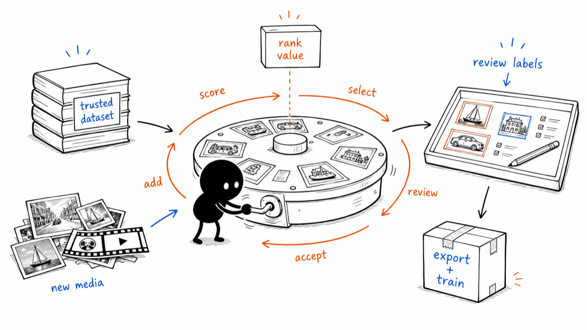
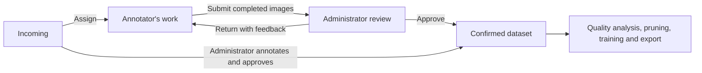
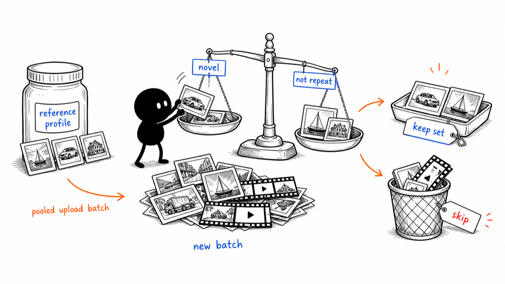
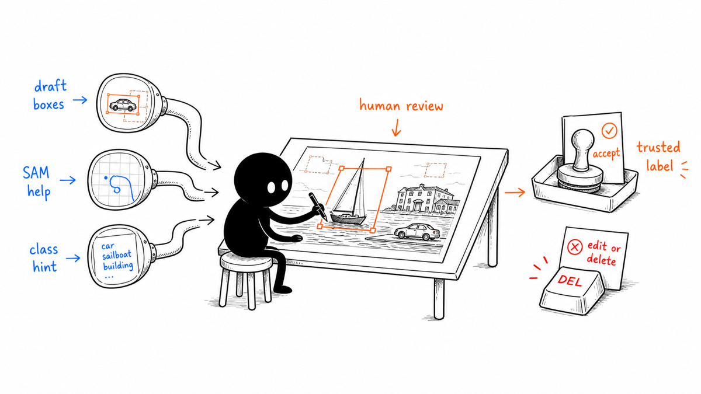
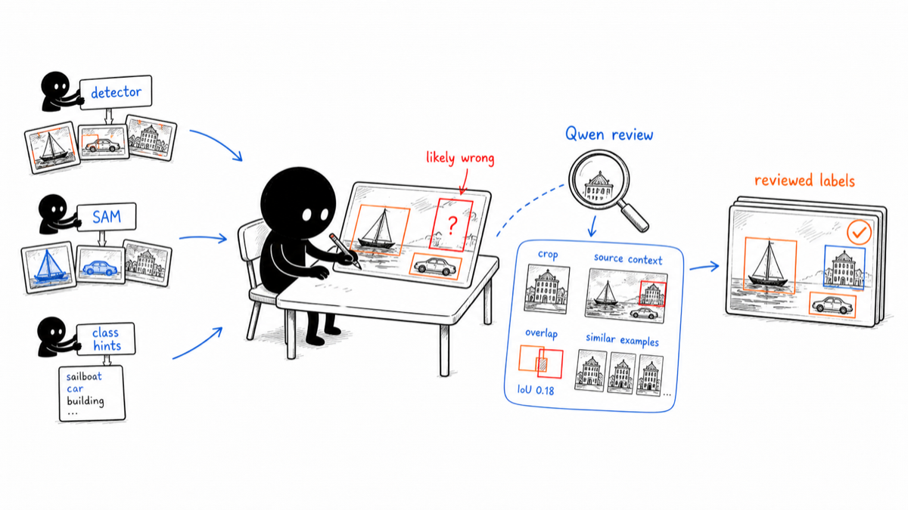
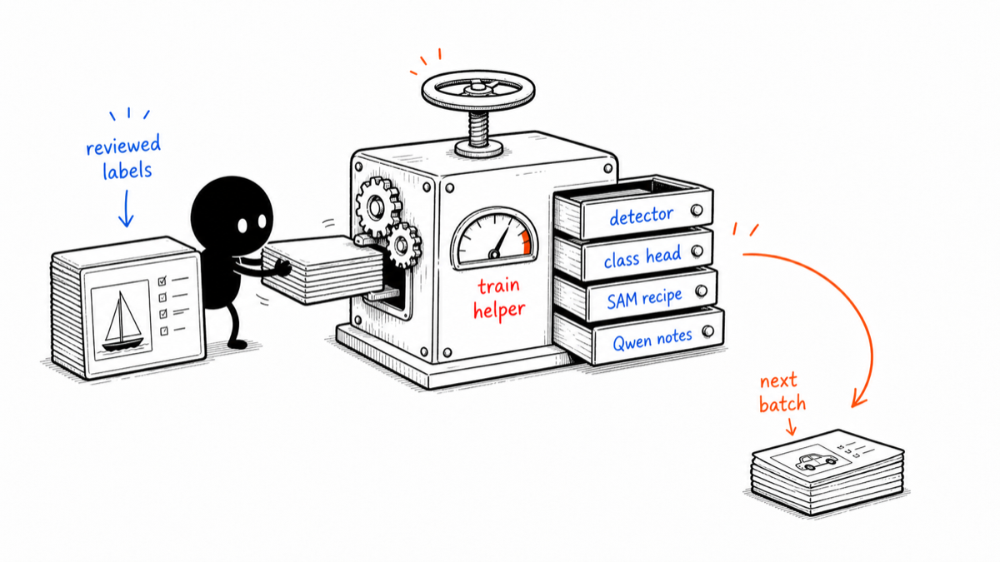

# Tator

Tator is a self-hosted platform for managing image datasets and annotating them
with help from detection, segmentation and vision-language models. The server
stores the images, annotation history and approved dataset. People sign in from
a browser to annotate, review or manage the work.

It also includes the original single-user local workbench. Both use the same
annotation canvas and drawing shortcuts; their storage and access rules differ.

**Start here:** [Install Tator](#install-tator) ·
[Use the hosted workspace](docs/hosted_workflow.rst) ·
[All documentation](docs/index.rst)



## From incoming images to a trusted dataset

New images enter **Incoming**. They become part of the **Confirmed** dataset only
after an administrator approves their annotations.



An annotator can submit one finished image at a time. Unfinished images stay in
their work queue. The administrator can approve submitted images or return them
with a note explaining what needs changing.

| Role | What they do |
| --- | --- |
| **Administrator** | Create datasets, import images, invite users, assign work, review submissions, manage models and run dataset analysis. |
| **Annotator** | Work on their assigned images, use the available annotation tools, save drafts and submit finished work. |

Each image has one editing owner at a time. While it is assigned or returned to
an annotator, an administrator can inspect it but must explicitly take it back
before editing. Submission hands editing control to the administrator. Assignment
is limited to incoming data; confirmed images remain under administrator control.

## What you can do

### Choose useful new images

Compare incoming images with a trusted reference dataset to find useful variety
and avoid spending annotation time on repeated views. In hosted mode, the
administrator compares selected Incoming images with a frozen confirmed snapshot.
The local ingestion workbench also accepts videos for frame selection.



[Incoming-data analysis](docs/hosted_analysis.rst) explains how the comparison
feeds into annotation. Skipping a candidate does not delete its source file.

### Annotate with assistance

Use manual boxes and polygons, SAM/SAM3 prompts, class prediction, detector
suggestions, detection recipes and Qwen tools. Annotators have access to the
configured first-pane tools. They inspect and correct the results, then submit
finished images for administrator approval.



Interactive SAM/classifier state is private to each user. Detector requests share
a sequential pipeline per dataset. Versioned saves and editor leases protect
against stale tabs and competing edits.

### Inspect quality and remove repetition

The Data Quality Explorer uses image and object embeddings to inspect similarities
and suspicious labels. Its existing review tools combine visual evidence with
model assistance; a person decides which changes to apply. Hosted analyses use
frozen confirmed data, so unfinished annotation stays outside their results.



[Dataset pruning](docs/dataset_pruning.rst) combines whole-image and object
similarity. Adjust the object weight and removal budget, inspect unique-object
loss, and protect valuable images before exporting a smaller dataset variant.
Original uploads and earlier annotation versions remain available.

### Train helpers for the next batch

Reviewed data can improve the detectors, class predictors and reusable recipes
used for later annotation. The local workbench provides training and recipe
controls; hosted administrators run the tasks configured for their server and
attach compatible installed models to each dataset.



[Models and compute](docs/hosted_runtime.rst) covers worker configuration and model
installation. Heavy analyses and training use the server's configured workers;
installing the workspace alone does not install model weights.

## Install Tator

Choose **hosted** for shared server-owned datasets, accounts and review queues.
Choose **local** for the original single-user workbench. They are separate
services; running the local launcher does not create hosted user accounts.

First get the source:

```bash
git clone https://github.com/stephansturges/Tator.git
cd Tator
```

### Hosted workspace: first installation

You need Python **3.11–3.13** linked to **SQLite 3.51.3 or newer**, Git, and an HTTPS
address for the server. The commands below start a new installation under your
current OS account. For a persistent Linux service, use the
[deployment guide](docs/hosted_deployment.rst), which includes the service account,
systemd configuration, updates and rollback.

**1. Install the control application.** Run from the repository root:

```bash
python3.11 -m venv .venv
.venv/bin/python -m pip install -r requirements-hosted.txt
.venv/bin/python -c 'import sqlite3; print(sqlite3.sqlite_version); assert sqlite3.sqlite_version_info >= (3, 51, 3), "Use a Python build linked to SQLite 3.51.3 or newer"'
.venv/bin/python -m pip check
```

Check the SQLite version used by Python, not just the system `sqlite3` command.
If this check fails, choose a compatible Python build before continuing; installing
Python packages does not upgrade its linked SQLite library.

**2. Create private storage outside the checkout.** Choose a new directory;
never point this at an existing dataset:

```bash
umask 077
export TATOR_HOSTED_STATE_DIR="$HOME/tator-hosted-state"
mkdir -m 700 "$TATOR_HOSTED_STATE_DIR"
```

**3. Set up HTTPS.** For a private deployment with Tailscale already installed
and joined to your tailnet, expose the loopback service:

```bash
tailscale serve --bg http://127.0.0.1:8010
tailscale serve status
```

Copy the HTTPS address shown by Serve into the following setting, replacing the
example. Use the exact origin without a trailing path. A local HTTPS reverse proxy
can also forward to the same loopback port; see the deployment guide.

```bash
export TATOR_HOSTED_ORIGIN='https://your-server.your-tailnet.ts.net'
```

**4. Create the first administrator and start the server.** Keep using this shell
so the exported settings remain available:

```bash
.venv/bin/python -m tools.hosted_admin \
  --state-dir "$TATOR_HOSTED_STATE_DIR" administrator

.venv/bin/python -m uvicorn hosted_app:create_app --factory \
  --host 127.0.0.1 --port 8010 --workers 1 \
  --proxy-headers --forwarded-allow-ips 127.0.0.1 --no-access-log
```

The bootstrap prompts for a password; run it only for the first account. Leave
the server terminal running, open your HTTPS address and sign in. From another
terminal, `curl --fail https://your-server.your-tailnet.ts.net/health` should
return `{"status":"ok","mode":"hosted"}` using your actual hostname. This checks
the control application, not model readiness. For later starts, restore both
`TATOR_HOSTED_*` settings and run the Uvicorn command; do not bootstrap again.

**5. Configure tools and try the workflow.** Manual annotation works before any
models are installed. For assistance and heavy analysis, install the selected
platform's inference dependencies into this same environment, configure
`TATOR_HOSTED_MODEL_CONFIG` with the **path to a JSON file** containing compatible
model definitions, and restart the server with those settings. Then use
**Tools & models** to install and select the models. The
[runtime guide](docs/hosted_runtime.rst) and
[model configuration example](deployment/hosted/models.example.json) describe
this step; the example enables no models until you configure them.

Create a small dataset, add images, invite an annotator through **People**, assign
images, then exercise submission and approval. Follow the
[administrator and annotator walkthrough](docs/hosted_workflow.rst). Before moving
a real dataset, follow [migration](docs/hosted_migration.rst), install `age` for
[encrypted backups](docs/hosted_operations.rst), and rehearse a restore.

The hosted workflows have local API and browser verification. GPU/model execution,
real-dataset migration and final cutover still need the target-machine acceptance
checks in the deployment guide.

### Local workbench: Apple Silicon

Install Python **3.11** and Poetry, then run from the repository root:

```bash
poetry install --only-root
poetry run tator-setup macos
cp -n .env.macos.example .env.macos
tools/run_macos_backend.sh
```

The setup command creates `.venv-macos`; the launcher loads `.env.macos` and serves
both UI and API. Open **http://127.0.0.1:8000/** and leave the terminal running.
To choose another port, use `PORT=8080 tools/run_macos_backend.sh`. Edit
`.env.macos` for model paths and runtime choices; the copy command preserves an
existing file. To select a Python executable explicitly, add
`--python /path/to/python3.11` to `tator-setup macos`.

[macOS inference setup](docs/macos_inference_setup.md) covers model downloads,
MLX/MPS selection and runtime checks.

### Local workbench: Linux

With Python **3.11** and Poetry installed, choose the general Linux profile:

```bash
poetry install --only-root
poetry run tator-setup linux
cp -n .env.example .env
.venv/bin/python -m uvicorn app:app --host 127.0.0.1 --port 8000 --env-file .env
```

Open **http://127.0.0.1:8000/** on that machine. This is the local inference API,
so use hosted mode for a shared login-based deployment. Choose Torch/CUDA and model
weights for the actual hardware; the
[environment guide](docs/environment_setup.md) also documents the pinned Falcon
profile. These local setup profiles are separate from hosted server setup.

## Documentation

The [documentation index](docs/index.rst) separates everyday workflows, server
operations, implementation references and local-workbench guides.

| You want to… | Read |
| --- | --- |
| Create a dataset, delegate annotation and review it | [Hosted workflow](docs/hosted_workflow.rst) |
| Install or update the shared server | [Deployment](docs/hosted_deployment.rst) |
| Move existing data into the hosted workspace | [Migration](docs/hosted_migration.rst) |
| Back up, restore, export or archive data | [Operations](docs/hosted_operations.rst) |
| Configure assistance models and shared compute | [Runtime](docs/hosted_runtime.rst) |
| Understand snapshot-based quality analysis and ingestion | [Hosted analysis](docs/hosted_analysis.rst) |
| Understand pruning controls and coverage | [Dataset pruning](docs/dataset_pruning.rst) |
| Work on the browser UI or use operator commands | [Frontend](ybat-master/README.md) · [Tools](tools/README.md) |

## Credits and model terms

The annotation canvas began with Ybat. Tator builds on model families and libraries
including SAM/SAM3, Qwen, YOLO, RF-DETR, CLIP, DINOv3, C-RADIO and MLX.
Check the terms of the models and datasets you use; their licenses also matter
when you train a model or distribute an exported dataset.
